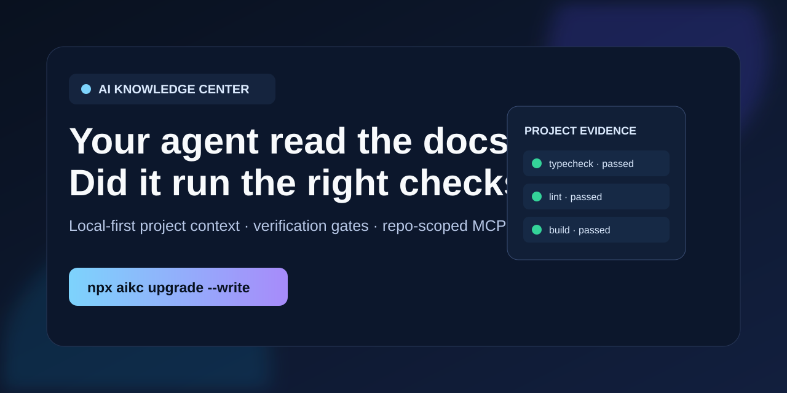
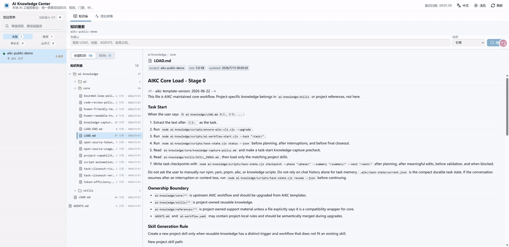

# AI Knowledge Center

**Local-first project context, verification gates, and repo-scoped MCP for coding agents.**

AI Knowledge Center (AIKC) helps Codex, Claude Code, Cursor, and similar
coding agents use the right project knowledge, discover approved checks, and
leave verification evidence instead of guessing their workflow.



### 18-second product walkthrough

The real local dashboard below shows project knowledge alongside persistent
verification evidence from five passed workflow gates. It uses a public-safe
example project; no user project data is recorded.



It is not another agent runtime or a generic skills library. AIKC is a
lightweight control layer for the repository you already have: a CLI, local
dashboard, project manifest, and stdio MCP server.

## Quick Start

Run this inside a project you want to initialize. The upgrade is additive: it
defaults to dry-run, and `--write` creates missing files while preserving
conflicting files as merge candidates.

```powershell
npx -y ai-knowledge-center@latest upgrade --project . --write --ai
npx -y ai-knowledge-center@latest doctor --project . --json
npx -y ai-knowledge-center@latest context-pack --project . --task "describe the task" --summary
npx -y ai-knowledge-center@latest
```

Open `http://127.0.0.1:4318`. See [reproducible examples](docs/examples.md)
and the [runnable example projects](examples/README.md) for a new TypeScript
project, safe upgrades of existing projects, and repository-scoped MCP.

## Why AIKC

- **Less irrelevant context** — project knowledge, skills, and context packs
  are discoverable without dumping every document into an agent prompt.
- **Verifiable delivery** — manifests declare gates and allowed commands so an
  agent can report what it ran and what remains risky.
- **Bounded by default** — the dashboard listens only on localhost; MCP is
  repository-scoped and commands are manifest-allowlisted.

## Security and privacy

- Production binds to `127.0.0.1` by default. `--host 0.0.0.0` is an explicit
  opt-in for LAN exposure.
- Start MCP with `aikc mcp --project <path>` to scope it to one repository.
- Optional integrations declare capabilities; they do not silently grant
  network, browser, GitHub, semantic-search, or broader filesystem access.
- Disable telemetry export with `AIKC_TELEMETRY_EXPORTER=none`.

Read the [MCP and local security model](docs/mcp-security.md) before enabling
commands or integrations in a shared project.

See the [coding-agent compatibility matrix](docs/compatibility.md) for the
portable surfaces and client-specific setup boundary.

AIKC is MIT-licensed. See [third-party notices](THIRD_PARTY_NOTICES.md) for
the reproducible dependency record and release audit commands.

It is designed to be installed as a single global npm CLI. After installation, one command starts one HTTP server that serves both the UI and API from the same port.

## Features

- Project menu with search and status filters.
- Document-first workspace with project context kept in a side panel.
- Focused project context view for Git status, knowledge assets, MCP, telemetry, Dagger, gates, and commands.
- Knowledge list sorted by references, updated time, or created time.
- Knowledge search and Markdown preview.
- Gate and command declarations are displayed as metadata for humans; automation and AI agents can consume the API separately.
- Repo-scoped MCP server mode with structured tools for manifests, doctor, context-pack, knowledge search, skills, and allowlisted commands.
- Optional integration declarations for docs lookup, browser QA, GitHub automation, and adjacent agent tools without silently granting those capabilities.
- Single exposed port in production: UI and `/api/*` are served by Fastify.

## Install

From npm:

```powershell
npm install -g ai-knowledge-center
```

From a local checkout:

```powershell
cd C:\Users\youni\Documents\GitHub\ai-knowledge-center
npm install
npm run build
npm install -g .
```

Verify the CLI:

```powershell
aikc --help
```

## Project setup and upgrades

Run `aikc upgrade --project . --write --ai` (or the `npx` command above) from
the target repository. It creates and upgrades the AIKC workflow safely:

- `ai-knowledge/core/**` for AIKC-maintained core workflow;
- `ai-knowledge/skills/**` for project-owned reusable skills;
- `ai-workflow.yaml`, `AGENTS.md`, and internal AI workflow scripts under `ai-knowledge/scripts`;
- `.aikc/upgrade/AI_UPGRADE_PROMPT.md` for semantic merge guidance.
- a user-level registry entry in `~/.ai-knowledge-center/config/projects.json` so the dashboard can find the project after initialization.
- a closeout rule that asks the Agent to package repeated operations as scripts, skills, MCP/server tools, or references when doing so reduces future token and command-discovery cost.
- `ai-knowledge/core/token-efficiency.md` with rules for minimal context loading, summaries before raw logs, structured output, caches, operations indexes, doctor commands, and compact closeout.
- `ai-knowledge/core/open-source-token-tools.md` with guidance for optional docs, repository-docs, and semantic-code MCPs without broadening default permissions.
- `ai-knowledge/core/bounded-loop-policy.md` with rules that Agent loops must define input, output, validation, budget, stop condition, and human escalation.
- `ai-knowledge/core/human-readable-knowledge-policy.md` with the two-layer knowledge rule: compact AI-facing knowledge first, human-readable companions under `ai-knowledge/human/**` only when meaning changes or missing companions are backfilled.
- `ai-knowledge/core/project-capabilities.md` with AIKC manifest, dashboard, gates, commands, MCP, telemetry, Dagger, API automation, project discovery, upgrade, and release behavior.
- `ai-knowledge/scripts/doctor.cjs`, `context-pack.cjs`, and `eval-workflow.cjs` for compact diagnostics, token-aware context planning, and workflow smoke evals.
- `ai-workflow.yaml` `loops` metadata for bounded task, upgrade, and release workflows.
- `ai-knowledge/core/open-source-usage.md` with rules for preferring mature packages over custom implementations when doing so improves reliability and reduces repeated agent work.
- `ai-knowledge/core/code-review-policy.md` with rules that code review and all applicable gates must pass before completion.

When an operation will be repeated, ask the Agent to package it with explicit local host OS and remote target OS boundaries. Use scripts for deterministic command sequences, skills for judgment-heavy workflows, and MCP/server tools for structured repeated operations.

When a task wastes context, ask the Agent to follow `ai-knowledge/core/token-efficiency.md` and `ai-knowledge/core/open-source-token-tools.md`, then prefer summaries, structured tool output, caches, operations indexes, doctor commands, Context7 docs lookup, or repo-scoped semantic retrieval instead of rereading large files or logs.

When a task creates or changes an Agent loop, ask the Agent to follow `ai-knowledge/core/bounded-loop-policy.md` so the loop has clear inputs, outputs, validation, budget, stop condition, and human escalation.

When a task changes AI-facing knowledge or skills, ask the Agent to follow `ai-knowledge/core/human-readable-knowledge-policy.md`: keep Agent files compact, update the human-readable companion only when meaning changes, and backfill missing companions under `ai-knowledge/human/**`.

When a task touches AIKC setup or dashboard behavior, ask the Agent to follow `ai-knowledge/core/project-capabilities.md` before changing manifests, gates, MCP, telemetry, Dagger, API automation, project discovery, upgrade behavior, or release flow.

When maintaining older projects, run the latest upgrade command again. AIKC safely adds missing workflow files, scripts, human-readable companions, evals, and manifest commands/gates/loops without overwriting project-specific knowledge. Differing files still become `*.aikc-upgrade.md` candidates for semantic merge.

When a task would require hand-rolled infrastructure, ask the Agent to follow `ai-knowledge/core/open-source-usage.md` and evaluate mature packages first.

After setup, normal project work starts with:

```text
按 ai-knowledge/LOAD.md 执行, 任务：<一句话描述任务>
```

## Start

Run the global CLI from anywhere. By default this starts the server in the background and keeps request logs quiet:

```powershell
aikc
```

Open:

```text
http://127.0.0.1:4318
```

The production CLI exposes only one port. The same server serves:

- `http://127.0.0.1:4318/` for the SPA UI
- `http://127.0.0.1:4318/api/health` for health
- `http://127.0.0.1:4318/api/projects` for project data

Use another port:

```powershell
aikc --port 5188
```

Run in the current terminal for debugging:

```powershell
aikc --foreground --log-level info
```

Stop the background server:

```powershell
aikc stop
```

Bind another host:

```powershell
aikc --host 0.0.0.0 --port 4318
```

Start AI Knowledge Center automatically when you log in:

```powershell
aikc autostart install
```

Check or remove the startup entry:

```powershell
aikc autostart status
aikc autostart uninstall
```

Autostart is supported on Windows and macOS. It starts the same local CLI with any startup options you pass to `autostart install`, such as `--port`, `--projects`, or `--config-dir`.

## MCP Server

AIKC can run as a repository-scoped MCP server for agent clients:

```powershell
aikc mcp --project C:\Users\youni\Documents\GitHub\ai-knowledge-center
```

The stdio MCP server exposes structured tools for project listing, manifest summaries, `doctor`, `context-pack`, knowledge search and preview, project skill listing, and allowlisted manifest command execution. Commands marked `dangerous: true` still require explicit confirmation.

Recommended project manifest entry:

```yaml
mcp:
  servers:
    - id: aikc
      label: AI Knowledge Center MCP
      type: stdio
      command: aikc
      args:
        - mcp
        - --project
        - .
      scope: repository
      description: Repo-scoped AIKC MCP tools for manifest, doctor, context-pack, knowledge search, skills, and allowlisted gates.
```

Keep filesystem MCP servers repository-scoped unless a task explicitly requires broader access.

## Configure Projects

The CLI loads projects in this order:

1. `--projects` or `AIKC_PROJECTS`
2. `--config-dir` or `AIKC_CONFIG_DIR`
3. `~/.ai-knowledge-center/config/projects.json`
4. Auto-discovery from the current working directory, `--workspace` / `AIKC_WORKSPACE`, and common local code folders such as `~/Documents/GitHub`, `~/Documents/Projects`, `~/GitHub`, `~/Projects`, and `~/source/repos`

Auto-discovery accepts a project root itself or one direct child folder containing `ai-workflow.yaml`, `ai-workflow.yml`, or `ai-knowledge/LOAD.md`.

`aikc upgrade --project . --write --ai` also registers the target project in `~/.ai-knowledge-center/config/projects.json` without replacing existing entries. This is the preferred persistent discovery path for initialized projects.

### Option 1: Pass Projects Directly

```powershell
aikc --projects "C:/Users/youni/Documents/GitHub/dota-legion-clean;C:/Users/youni/Documents/GitHub/my-tool"
```

PowerShell environment variable:

```powershell
$env:AIKC_PROJECTS = "C:/repo/a;C:/repo/b"
aikc
```

### Option 2: Use config/projects.json

Create `~/.ai-knowledge-center/config/projects.json`:

```json
{
  "projects": [
    {
      "path": "C:/Users/youni/Documents/GitHub/dota-legion-clean"
    },
    {
      "path": "C:/Users/youni/Documents/GitHub/my-new-ai-project",
      "id": "my-new-ai-project",
      "name": "My New AI Project",
      "description": "AI workflow project",
      "packageManager": "npm"
    }
  ]
}
```

Run with an explicit workspace:

```powershell
aikc --workspace C:\Users\youni\Documents\GitHub
```

Run with an explicit config directory:

```powershell
aikc --config-dir C:\Users\youni\Documents\GitHub\ai-config
```

## Project Manifest

Each project can expose knowledge, gates, commands, dashboard links, MCP, optional integrations, telemetry, and Dagger through `ai-workflow.yaml`.

Minimal example:

```yaml
schemaVersion: 1
id: my-project
name: My Project
knowledge:
  load: ai-knowledge/LOAD.md
  core: ai-knowledge/core
  aiLoad: ai-knowledge/ai/LOAD.md
  skills: ai-knowledge/skills
  skillIndex: ai-knowledge/skills/SKILL_INDEX.md
  closeoutPrompt: ai-knowledge/core/LOAD-END.md
  agentsFile: AGENTS.md
gates:
  - id: typecheck
    label: Typecheck
    script: typecheck
    packageManager: npm
    category: typecheck
commands:
  - id: closeout
    label: AI Closeout
    script: ai:closeout
    packageManager: npm
mcp:
  servers:
    - id: aikc
      label: AI Knowledge Center MCP
      type: stdio
      command: aikc
      args: [mcp, --project, .]
      scope: repository
integrations:
  docs:
    provider: context7
    mode: optional
    label: Context7 docs
  repoDocs:
    provider: custom
    mode: optional
    label: Repository docs MCP
  semanticCodeSearch:
    provider: custom
    mode: optional
    label: Semantic code-search MCP
  browserQa:
    provider: playwright
    mode: optional
    label: Playwright QA
  vcs:
    provider: github-mcp
    mode: optional
    label: GitHub MCP
dashboard:
  watch:
    - ai-knowledge
    - src
  links:
    - label: Repo
      url: https://github.com/example/my-project
```

`integrations` is declarative. It advertises useful optional helpers but does not itself grant network, browser, GitHub, semantic indexing, or broader filesystem access.

Use `command` when you need exact shell control:

```yaml
gates:
  - id: tests
    label: Tests
    command: pnpm test
    category: test
```

Use `dangerous: true` for commands that should require explicit confirmation when called through the API:

```yaml
commands:
  - id: deploy
    label: Deploy
    command: pnpm deploy
    dangerous: true
```

## Upgrade Existing Projects

Use the CLI as a scanner and distributor. Let an AI Agent do the semantic merge when a project already has templates, skills, prompts, or reply rules.

From inside the target project, give the Agent this complete one-sentence prompt:

```text
In this target project directory, initialize or upgrade the AI Knowledge Center workflow by first actively trying to update the global CLI with `npm install -g ai-knowledge-center@latest`, if that fails because of permission or locked files run `aikc stop` and retry `npm install -g ai-knowledge-center@latest` once, if it still fails report the failure and give the user the manual retry commands `aikc stop`, `npm install -g ai-knowledge-center@latest`, and `aikc`, then run `aikc upgrade --project . --write --ai` or `npx -y ai-knowledge-center@latest upgrade --project . --write --ai` if the global `aikc` command is unavailable, read `ai-knowledge/LOAD.md`, `ai-knowledge/core/LOAD.md`, and `ai-knowledge/ai/LOAD.md` when present, read `.aikc/upgrade/AI_UPGRADE_PROMPT.md` if it exists, semantically merge any `*.aikc-upgrade.md` candidates without overwriting human docs, config, package scripts, existing AI workflows, MCP settings, integrations, or uncommitted work, keep AIKC-maintained workflow in `ai-knowledge/core`, keep AI workflow scripts in `ai-knowledge/scripts` with human usage notes in `ai-knowledge/scripts/README.md` instead of polluting the host `package.json`, keep project-specific reusable knowledge in `ai-knowledge/skills` or project references, ensure `ai-workflow.yaml` keeps repo-scoped MCP defaults including `aikc mcp --project .` and does not broaden filesystem MCP scope without explicit user approval, treat `integrations` such as Context7 docs, repository-docs lookup, semantic code search, Playwright QA, and GitHub MCP as optional declarations unless the task explicitly needs network, browser, GitHub, semantic indexing, or broader filesystem access, follow `ai-knowledge/core/script-automation-policy.md`, `ai-knowledge/core/token-efficiency.md`, `ai-knowledge/core/open-source-token-tools.md`, `ai-knowledge/core/project-capabilities.md`, `ai-knowledge/core/open-source-usage.md`, `ai-knowledge/core/code-review-policy.md`, and `ai-knowledge/core/human-friendly-task-summary.md`, run `node ai-knowledge/scripts/doctor.cjs --json`, `node ai-knowledge/scripts/eval-workflow.cjs`, `node ai-knowledge/scripts/code-review.cjs`, `node ai-knowledge/scripts/knowledge-check.cjs`, and all applicable gates until they pass, and make the final reply include changed files, global CLI update result, code review result, validation, remaining risk, knowledge-capture decision, and reusable automation/token-efficiency decision when applicable.
```

Dry-run first:

```powershell
aikc upgrade --project C:\Users\youni\Documents\GitHub\dota-legion-clean
```

Apply safe scaffolding and write upgrade candidates:

```powershell
aikc upgrade --project C:\Users\youni\Documents\GitHub\dota-legion-clean --write
```

This command:

- creates missing AI workflow files;
- keeps existing project files unchanged when they differ;
- writes candidate files next to conflicts as `*.aikc-upgrade.md`;
- writes `.aikc/upgrade/AI_UPGRADE_PROMPT.md` for the Agent;
- registers the project in `~/.ai-knowledge-center/config/projects.json` without replacing existing entries;
- merges missing `package.json` scripts without replacing existing scripts.

If you already ran the command and only need the semantic merge step, ask the Agent in that project:

```text
Read .aikc/upgrade/AI_UPGRADE_PROMPT.md and upgrade this project's AI knowledge workflow by semantic merge.
```

After a project has the current template, normal task invocation also performs an automatic safe update. When the user says:

```text
按 ai-knowledge/LOAD.md 执行, 任务：...
```

the Agent reads `ai-knowledge/ai/LOAD.md` and runs:

```powershell
node ai-knowledge/scripts/ensure-aikc-cli.cjs --upgrade
node ai-knowledge/scripts/ai-workflow-start.cjs --task "<任务一句话>"
```

`ensure-aikc-cli.cjs --upgrade` checks whether the global `aikc` CLI exists and is current, actively tries to install or update it when needed, stops and restarts a running background Web process around the update, prints manual retry commands if npm global update still fails, then runs:

```powershell
aikc upgrade --project . --write --ai
```

If an `aikc` background Web process is already running when the global CLI is updated, the ensure script restarts that process automatically so the dashboard serves the newly installed version.

This keeps ongoing projects fresh without overwriting existing knowledge templates. Conflicts become `*.aikc-upgrade.md` candidates plus `.aikc/upgrade/AI_UPGRADE_PROMPT.md` for AI semantic merge.

The one-click script passes `--ai` by default so the handoff prompt is available after every upgrade. Use `--no-ai` with `ensure-aikc-cli.cjs --upgrade` only when you intentionally want to skip that prompt. You can also run `aikc upgrade` directly:

```powershell
aikc upgrade --project C:\repo\app --write --ai
```

`--force` exists for rare maintenance cases, but it overwrites conflicting templates after writing backups. Prefer AI semantic merge for real projects.

## CLI Options

```text
  aikc [options]
  aikc stop
  aikc doctor [--project <path>] [--json]
  aikc context-pack --project <path> --task <task> [--summary] [--enforce]
  aikc mcp [--project <path>]
  aikc autostart <install|uninstall|status> [options]
  aikc upgrade --project <path> [--write] [--ai] [--force]

Options:
  --host <host>          Bind host. Default: 127.0.0.1
  --port <port>          HTTP port. Default: 4318
  --projects <paths>     Project paths separated by semicolon or newline
  --workspace <path>     Workspace root used for project auto-discovery. Default: user home
  --config-dir <path>    Directory containing projects.json
  --log-level <level>    Fastify log level. Default: warn
  --foreground           Run the server in the current terminal for debugging
  --help                 Show help

MCP:
  --project <path>       Limit MCP context to one project root. Default: configured projects

Context pack:
  --project <path>       Target project root. Default: current directory
  --task <task>          Task description used for context routing
  --summary              Return the compact summary instead of the full plan
  --enforce              Fail when the selected context exceeds the token budget
  --max-total-tokens <n> Maximum total context tokens when enforcing

Autostart:
  install                Start AI Knowledge Center when the user logs in
  uninstall              Remove the login startup entry
  status                 Show whether the startup entry exists

Upgrade options:
  --project <path>       Target project root. Default: current directory
  --write                Create missing files, candidate templates, and an AI handoff prompt
  --ai                   Write the AI handoff prompt even when no conflict is detected
  --force                Overwrite conflicting templates after writing backups; use rarely
```

Environment variables:

| Variable | Purpose |
| --- | --- |
| `AIKC_HOST` | Bind host |
| `AIKC_PORT` | HTTP port |
| `AIKC_PROJECTS` | Semicolon or newline separated project paths |
| `AIKC_HOME` | AIKC state root. Default: `~/.ai-knowledge-center` |
| `AIKC_WORKSPACE` | Workspace root for project auto-discovery. Default: user home |
| `AIKC_CONFIG_DIR` | Directory containing `projects.json` |
| `AIKC_LOG_LEVEL` | Fastify log level. Default: `warn` |
| `AIKC_TELEMETRY_EXPORTER` | Set to `none` to disable telemetry export |
| `AIKC_TELEMETRY_SERVICE_NAME` | OpenTelemetry service name |

## Development

Development uses two local processes because Vite provides HMR:

```powershell
npm install
npm run dev
```

Open:

```text
http://127.0.0.1:5177
```

In development only:

- Vite serves the SPA on `5177`
- Fastify serves the API on `4318`
- Vite proxies `/api` to Fastify

Production/global install uses one port.

## Build

```powershell
npm run build
```

This creates:

- `dist/client` for the SPA
- `dist/server` for Fastify
- `dist/cli/aikc.js` for the global CLI

Run the built version locally:

```powershell
npm start -- --port 4318
```

## Publish

Before publishing:

```powershell
npm run typecheck
npm run lint
npm run build
npm pack --dry-run
```

Publish:

```powershell
npm publish
```

After publishing:

```powershell
npm install -g ai-knowledge-center
aikc
```

## API

Useful endpoints:

```text
GET  /api/health
GET  /api/projects
GET  /api/projects/:projectId
GET  /api/projects/:projectId/knowledge?sort=references
GET  /api/projects/:projectId/knowledge/search?q=keyword
GET  /api/projects/:projectId/knowledge/preview?path=ai-knowledge/LOAD.md
POST /api/projects/:projectId/run/:commandId
```

The UI is intentionally document-first and does not expose manual run buttons. The run endpoint remains available for trusted local automation or AI workflows that already understand the project manifest.

## Notes

- The tool reads project files from local checkouts; it does not copy knowledge into an internal database.
- Command execution is allowlisted by each project's manifest.
- Global install defaults to the directory where `aikc` is executed, not the package installation directory.
- Use `--host 0.0.0.0` only when you intentionally want LAN access.
